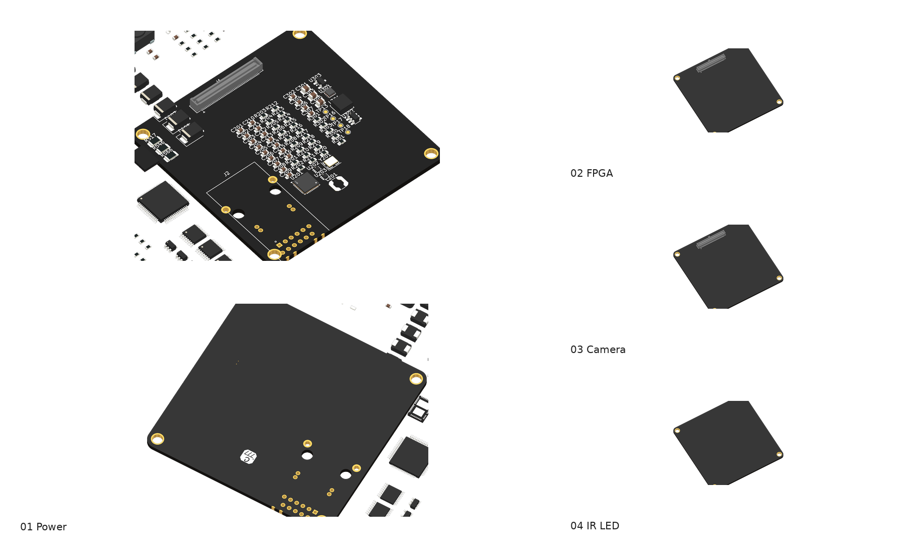

# woki cam

  

modular infrared camera for optical tracking of retroreflective markers.

KiCad projects are in `boards/`; reusable symbols, footprints and models are in `lib/`.
Supporting Python utilities are in `scripts/`; GitHub Actions configuration is in `.github/`.

Export STEP assemblies with `python scripts/export_step.py` (`--rewrite` replaces existing exports).
CI checks schematics strictly and generates draft outputs with layout reports.
Manufacturing releases require clean PCB checks.

The board inventory in `scripts/project.py` is shared by CI, exports, packaging and previews.

Board 1 drawings: [schematic](documentation/board-1.pdf) and [draft assembly views](documentation/board-1-assembly.pdf). Component references remain available on the fabrication layer when omitted from crowded silkscreen.
